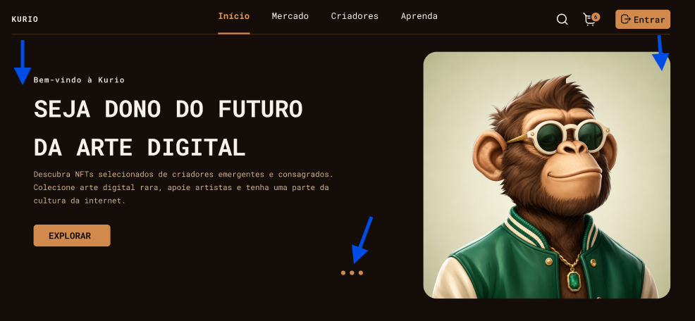
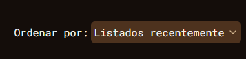
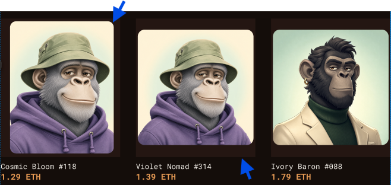
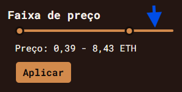
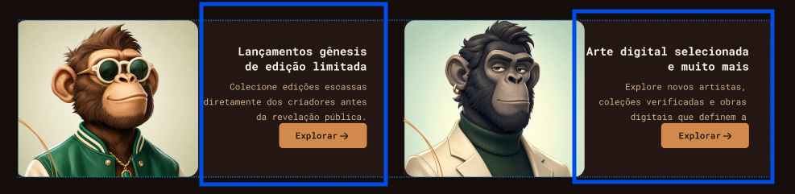
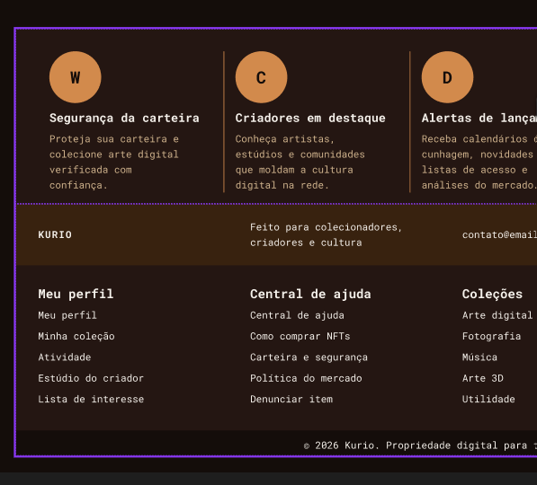
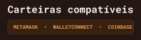
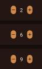

# Arquitetura

Este documento registra como organizei o Kurio, os contratos que a interface consome, a política de cache e sincronização, e as decisões que não ficam óbvias lendo o código. Instruções de execução estão no [README](../README.md).

## Visão geral

A aplicação é uma SPA em React 19 com TypeScript, Vite, TanStack Router (rotas em arquivo com code splitting automático), TanStack Query, Axios, Zod, react-hook-form, Tailwind 4 e componentes shadcn adaptados ao design. Não existe backend: o MSW intercepta as chamadas REST e a conexão Socket.IO dentro do próprio browser, em desenvolvimento, nos testes e no deploy. Os mocks mantêm um banco em memória persistido em `localStorage`, então refresh preserva sessão, carrinho, pedidos e alterações de perfil.

Escolhi deixar os mocks no build de produção de propósito. O desafio pede uma URL pública funcionando sem infraestrutura, e a mesma camada atende desenvolvimento, demonstração e os testes E2E, sem caminhos alternativos de negócio em componentes ou hooks.

## Estrutura e responsabilidades

```
src/
  api/        cliente Axios, contratos Zod (request, response, eventos, erros) e chaves de query
  routes/     uma rota por arquivo; validam search params, protegem fluxos privados e fazem prefetch
  features/   lógica de cada domínio: queries, mutations, hooks e componentes específicos
  components/ layout, campos de formulário, estados vazios/erro, ícones e primitivos de UI
  lib/        aritmética de ETH, storage, socket, media query e utilitários sem domínio
  mocks/      handlers MSW, banco persistido, seed determinística, cenários e servidor Socket.IO
```

Cada camada tem um papel fixo:

- `api/schemas` é a única fonte de tipos de transporte. Os handlers do MSW importam os mesmos schemas para validar entrada e montar saída, então cliente e servidor simulado nunca divergem.
- `api/endpoints` faz a chamada e valida a resposta com Zod antes de devolver. Um contrato quebrado falha na borda, não dentro de um componente.
- `features/*/queries.ts` define `queryOptions` reutilizáveis entre loaders de rota e hooks, com a chave vinda de `api/query-keys`.
- Rotas só compõem: validam a URL, disparam prefetch e renderizam a feature. Regras de negócio ficam nos hooks e nos handlers.

## Boot e mocks

`main.tsx` renderiza a aplicação imediatamente e, em paralelo, importa o módulo de mocks de forma dinâmica e registra o service worker. Uma promise `mocksReady` é resolvida ao final (com sucesso ou não). O interceptor de requisição do Axios aguarda essa promise antes de enviar qualquer chamada, e o socket só é importado depois dela, porque o engine.io captura `globalThis.WebSocket` no momento do import e precisa encontrar a versão já interceptada pelo MSW.

O build separa chunks de `vendor` (React, Router, Query, Axios, Zod), `realtime` (socket.io-client) e `mocks` (MSW e parsers), e injeta `modulepreload` dos chunks de mocks no HTML para que o worker esteja pronto o mais cedo possível. Mesmo assim o peso dos mocks é o principal custo do perfil mobile no Lighthouse (ver seção de performance).

Na primeira carga, os parâmetros `?scenario=` e `?reset=1` são aplicados antes de o worker iniciar e removidos da URL com `replaceState`.

## Contratos REST

Base: `VITE_API_URL` (`/api`). Autenticação por `Authorization: Bearer <token>`. Carrinho de visitante por `X-Guest-Cart: <id>`. Corpo e resposta em JSON.

| Recurso          | Método e caminho                                                                           | Observações                                                                                                                |
| ---------------- | ------------------------------------------------------------------------------------------ | -------------------------------------------------------------------------------------------------------------------------- |
| Cadastro         | `POST /auth/register`                                                                      | 201 com `{ user, token, expiresAt }`; 409 `CONFLICT` com `fields.email` ou `fields.username`                               |
| Login            | `POST /auth/login`                                                                         | 200 com `{ user, token, expiresAt }`; 401 `UNAUTHENTICATED`                                                                |
| Sessão           | `GET /auth/session`                                                                        | `{ user, expiresAt }`; renova o TTL a cada chamada autenticada                                                             |
| Logout           | `POST /auth/logout`                                                                        | 204                                                                                                                        |
| Catálogo         | `GET /nfts?q&category&network&minPrice&maxPrice&sort&tab&page`                             | `{ items, page, pageSize, total, totalPages, facets }`, 9 por página                                                       |
| Detalhe          | `GET /nfts/:slug`                                                                          | NFT completo com edições, atributos e `version`                                                                            |
| Relacionados     | `GET /nfts/:slug/related`                                                                  | `{ items }`                                                                                                                |
| Conteúdo da home | `GET /content/home`                                                                        | banner, promoções e posts do blog                                                                                          |
| Favoritos        | `GET /favorites`, `PUT /favorites/:nftId`, `DELETE /favorites/:nftId`                      | `{ nftIds, items }`; mutations respondem 204                                                                               |
| Carrinho         | `GET /cart`, `POST /cart/items`, `PATCH /cart/items/:itemId`, `DELETE /cart/items/:itemId` | sempre devolvem o carrinho inteiro com `version`                                                                           |
| Cupom            | `PUT /cart/coupon`, `DELETE /cart/coupon`                                                  | 422 `VALIDATION` com `fields.code` para inválido ou expirado                                                               |
| Cotação          | `POST /quote`                                                                              | calcula linhas, disponibilidade, desconto, taxa de rede e total; expira em 2 min                                           |
| Pedidos          | `POST /orders` (header `Idempotency-Key`), `GET /orders/:orderId`                          | 201 pendente; 409 `QUOTE_STALE` com `quote` nova; 409 `IDEMPOTENCY_MISMATCH`; 403 `FORBIDDEN` para pedido de outro usuário |
| Perfil           | `GET /profile`, `PATCH /profile`, `PATCH /profile/avatar`, `POST /profile/password`        | avatar como data URL; senha confere a atual                                                                                |
| Carteiras        | `GET /wallets`, `PUT /wallets/:slot`                                                       | slots `primary` e `secondary`; endereço validado por rede                                                                  |

Erros têm sempre o formato `{ error: { code, message, fields? } }`. Os códigos são `VALIDATION` (422), `UNAUTHENTICATED` (401), `FORBIDDEN` (403), `NOT_FOUND` (404), `CONFLICT` (409), `QUOTE_STALE` (409), `IDEMPOTENCY_MISMATCH` (409) e `UNAVAILABLE` (503). Falha de rede e timeout chegam sem resposta e são tratados pelo Axios. `fields` carrega mensagens por campo e é aplicado direto nos formulários com `applyFieldErrors`.

Valores em ETH trafegam como string decimal (`"1.39"`), nunca como número. Toda soma, multiplicação e percentual passa por `lib/eth.ts`, que converte para `bigint` em wei e volta, para que o total do carrinho nunca sofra erro de ponto flutuante.

Os endpoints de controle `GET /__mock/scenarios`, `PUT /__mock/scenario`, `POST /__mock/reset`, `POST /__mock/emit`, `POST /__mock/socket/disconnect` e `GET /__mock/socket/connections` existem só para o painel de simulação e os testes.

## Eventos em tempo real

O cliente conecta a `VITE_SOCKET_URL` com socket.io-client em transporte `websocket`, enviando `{ token, guest }` no handshake. O servidor simulado lê o pacote CONNECT, resolve a sessão e associa a conexão ao dono do carrinho. Ao conectar, ele também liquida pedidos pendentes cujo prazo já venceu, para que um refresh após a queda da aba conclua a compra.

| Evento          | Payload                                                                  | Quem recebe                      |
| --------------- | ------------------------------------------------------------------------ | -------------------------------- |
| `nft.updated`   | `{ eventId, nftId, version, price, previousPrice, editions }`            | todas as conexões                |
| `order.updated` | `{ eventId, orderId, userId, version, status, txHash, rejectionReason }` | só as conexões do dono do pedido |

Cada entidade tem um `version` inteiro incrementado a cada mudança, e cada evento tem um `eventId` único. Isso é a base da reconciliação descrita adiante.

## Sessão

O token fica em `localStorage` (`kurio:session`) junto com `userId` e `expiresAt`. Ao recarregar, a interface considera o usuário "carregando" até `GET /auth/session` confirmar; só então as rotas privadas renderizam dados. O servidor simulado guarda um TTL de 30 minutos renovado a cada requisição autenticada. Senhas são armazenadas como SHA-256 com prefixo fixo, nunca em claro.

Rotas privadas vivem sob o layout `_auth`, cujo `beforeLoad` redireciona para `/login?redirect=<href>` se não há sessão armazenada. O parâmetro `redirect` só é aceito se for um caminho interno (começa com `/`, não com `//`) e não aponta para login ou cadastro.

Qualquer resposta 401 com sessão ativa passa pelo interceptor do Axios: a sessão local é apagada, as queries privadas (`session`, `favorites`, `cart`, `quote`, `orders`, `profile`, `wallets`) são removidas do cache, um aviso aparece e o usuário vai para o login com a URL atual preservada. No checkout o rascunho fica em `sessionStorage` por usuário, então ao entrar de novo o formulário e a chave de idempotência voltam.

Login e logout chamam `queryClient.clear()`. Isso descarta qualquer dado do usuário anterior, inclusive listas públicas que poderiam ter sido montadas com cabeçalho de outro dono, e força o socket a reconectar com o novo handshake. As chaves de query de dados privados incluem o `userId` ou a chave do carrinho, então mesmo sem o clear duas contas não compartilhariam entradas.

## Carrinho

O carrinho pertence a um `ownerKey`: `user:<id>` para quem está logado ou `guest:<id>` para visitantes. O id de visitante é criado no primeiro "Adicionar ao carrinho" e guardado em `localStorage` (`kurio:guest-cart`); o Axios o envia em `X-Guest-Cart`. No login ou cadastro o servidor funde o carrinho de visitante no do usuário, somando quantidades até o limite disponível e preservando o cupom se o usuário não tinha um, e o cliente apaga o id de visitante.

O servidor é a fonte de verdade de preços e disponibilidade. Cada item guarda `priceAtAdd` para que a cotação consiga apontar o que mudou. `POST /quote` recalcula tudo a partir do estado atual: reduz quantidades acima do disponível, marca linhas esgotadas, aplica o cupom em pontos-base, escolhe a taxa de rede pela rede predominante no carrinho e devolve `issues` legíveis. O cliente nunca soma valores; ele exibe a cotação.

Toda mutation de carrinho devolve o carrinho completo e o grava direto no cache, e invalida a cotação. Erros `CONFLICT` e `NOT_FOUND` (edição esgotada, item removido) invalidam catálogo, carrinho e cotação, porque indicam que o cache local ficou para trás.

## Política de cache, retries e sincronização

Defaults do `QueryClient`: `staleTime` de 30 s, sem refetch ao focar a janela, até duas tentativas com backoff exponencial de 500 ms a 4 s, mas nunca para erros 4xx. Mutations não fazem retry automático. Por cima disso:

| Dados                                     | `staleTime`                                               | Refetch                   | Motivo                                |
| ----------------------------------------- | --------------------------------------------------------- | ------------------------- | ------------------------------------- |
| Catálogo, detalhe, relacionados, conteúdo | 30 s                                                      | ao montar quando obsoleto | públicos e corrigidos por eventos     |
| Sessão                                    | 5 min, sem retry                                          | ao montar                 | um 401 já encerra a sessão            |
| Favoritos                                 | 60 s                                                      | ao montar                 | atualização otimista cobre a latência |
| Carrinho e cotação                        | 0                                                         | foco, reconexão, montagem | dinheiro e estoque, sempre frescos    |
| Pedido                                    | 0, polling de 5 s enquanto pendente, sem retry em 403/404 | foco, reconexão           | fallback caso o socket falhe          |

Toda query recebe o `AbortSignal` do TanStack Query, então uma busca no catálogo abandonada (por exemplo no cenário de respostas fora de ordem) é cancelada e não sobrescreve a resposta mais nova. A chave da lista inclui o objeto completo de filtros, de modo que cada combinação de busca, categoria, rede, faixa de preço, ordenação, aba e página é uma entrada isolada.

Favoritar é a interação otimista: `onMutate` cancela a query, grava o novo estado, e `onError` restaura o snapshot e avisa. `onSettled` invalida para alinhar com o servidor.

Os loaders de rota fazem `prefetchQuery` sem bloquear a navegação, aproveitando o cache quando a entrada ainda é válida.

## Reconciliação entre REST e Socket.IO

A regra é simples: o cache aceita uma mudança apenas se ela for mais nova que o que ele já tem, e o REST sempre pode confirmar o estado final.

- Cada evento passa por um deduplicador de `eventId` (conjunto limitado a 500 entradas). Um evento repetido pela reconexão é descartado.
- `nft.updated` só é aplicado em entradas de catálogo, detalhe e relacionados cujo `version` seja menor que o do evento. Um evento atrasado ou fora de ordem não regride o preço. A atualização é feita em memória com `setQueryData`, sem refetch, e depois carrinho e cotação são invalidados para que o servidor recalcule totais. O aviso aparece como toast e como banner persistente nas telas de carrinho e pagamento.
- `order.updated` é aplicado só se o `userId` do evento for o da sessão atual e o `version` for mais novo. Se o pedido ainda não estava no cache, a query é invalidada em vez de montada a partir do evento.
- Em toda reconexão (exceto a primeira), o cliente invalida carrinho, cotação, pedidos e os detalhes de NFT ativos. Isso cobre os eventos perdidos enquanto o socket esteve fora.
- A tela do pedido mantém polling de 5 s enquanto o estado é pendente, independente do socket. Se o evento chegar primeiro, o polling para na próxima verificação; se o socket cair, o polling conclui o fluxo.

Quando o cliente não recebe um `nft.updated` (socket caído, aba em segundo plano), a confirmação de compra ainda é segura, porque o servidor compara a cotação enviada com uma recalculada e responde `QUOTE_STALE` com a nova.

## Checkout e idempotência

O rascunho do checkout fica em `sessionStorage` por usuário (`kurio:checkout:<userId>`) e guarda os campos do formulário, o provedor e a carteira escolhidos, o estado da conexão simulada, uma `idempotencyKey` e um `pendingOrderId`.

A chave de idempotência é gerada uma vez por tentativa de compra e enviada no header `Idempotency-Key`. No servidor:

1. Chave já usada pelo mesmo usuário com o mesmo corpo (hash SHA-256 de um JSON canônico, com chaves ordenadas): devolve o mesmo pedido, sem criar outro.
2. Mesma chave com corpo diferente: 409 `IDEMPOTENCY_MISMATCH`.
3. Chave nova: valida a cotação. Se o carrinho mudou de `version`, algum NFT mudou de `version`, a cotação expirou, o total recalculado difere ou há linha indisponível, responde 409 `QUOTE_STALE` com a cotação atual. Caso contrário cria o pedido pendente, registra a chave e agenda a liquidação em 3 s.

No cliente, `useCreateOrder` reenvia uma única vez com a mesma chave quando a primeira tentativa estourou o timeout de 8 s do Axios. É isso que faz o cenário de timeout terminar com um único pedido: a segunda chamada cai no caso 1. Cliques repetidos no botão não enviam nada enquanto a mutation está em andamento.

Quando a resposta é `QUOTE_STALE`, abro um diálogo comparando a cotação anterior e a nova linha a linha. Aceitar gera uma nova chave de idempotência (o corpo mudou, então a chave antiga daria conflito) e reenvia com o `quoteId` novo. Revisar leva ao carrinho.

Depois que o pedido é criado, `pendingOrderId` é gravado no rascunho e a navegação vai para `/pedido/:id`. Se o usuário recarregar ou perder a conexão, `/pagamento` consulta esse pedido e, se ainda estiver pendente, redireciona para ele em vez de permitir outra compra. Quando o pedido conclui (confirmado ou recusado), o rascunho é limpo e uma chave nova é gerada para a próxima compra. Pedido confirmado baixa o estoque das edições e remove os itens comprados do carrinho; pedido recusado mantém o carrinho intacto.

A conexão de carteira é simulada: escolher um provedor e clicar em "Conectar carteira" espera 1,2 s e conecta, ou recusa no cenário correspondente. Não há integração com extensão de carteira real.

## Cenários de simulação

A latência padrão é de 100 a 250 ms. O cenário ativo fica em `localStorage` (`kurio:scenario`) e é lido a cada requisição, então trocar no painel vale na próxima chamada. Cenários com estado (contagem de 503, 401 consumido, timestamp da última busca) são zerados ao trocar. A lista completa, com efeitos, está no README. O reset recria o banco a partir da seed, limpa sessão, carrinho de visitante, cenário e `sessionStorage`.

As fixtures são geradas por `scripts/generate-fixtures.mjs` com seed fixa: 60 NFTs distribuídos entre 9 categorias e 3 redes, com faixas de preço e disponibilidades que exercitam filtros, paginação e esgotamento (há edições 1/1 já esgotadas). Os nove primeiros reproduzem os cards do Figma. A versão da seed invalida bancos persistidos de versões anteriores.

## Decisões de UX

- Login e cadastro são um diálogo sobre a página inicial no desktop e uma página inteira no mobile, como no Figma. A rota é a mesma (`/login`, `/cadastro`) e o diálogo prende o foco e fecha com Escape sem perder o `redirect`.
- Filtros, busca, ordenação, aba e página do catálogo vivem na URL. Valores padrão são removidos da URL para manter links limpos, e qualquer valor inválido cai no padrão em vez de quebrar a página. Mudar um filtro volta para a página 1.
- Durante refetch em segundo plano a lista anterior continua visível com um indicador discreto; skeletons aparecem só na primeira carga.
- Erros de rede e 503 mostram um estado com "Tentar novamente"; o retry automático já aconteceu antes disso.
- Mudanças de preço e disponibilidade chegadas por evento aparecem como toast e, no carrinho e no pagamento, como banner fixo até serem dispensadas. Linhas afetadas mostram o preço anterior riscado ou a marcação de esgotado, e o botão de confirmar fica bloqueado enquanto houver linha indisponível.
- No mobile o pagamento é dividido em duas etapas (`?step=collector` e `?step=wallet`) para caber na tela, com o passo na URL para o botão voltar funcionar.
- O recibo é um diálogo no desktop e uma página no mobile. Fechar o diálogo mantém o recibo acessível na própria página.
- Áreas do layout que não fazem parte da entrega (links de rodapé, login social, newsletter, compartilhamento, menu "Criadores") não fingem que funcionam: ao serem acionadas mostram o toast informativo "Indisponível nesta versão", dizendo que aquela área não faz parte desta entrega. O menu "Aprenda" leva à seção "Diário da Cunhagem" da home.
- O botão central da barra inferior do mobile leva à conta do usuário. O ícone do carrinho no cabeçalho e na navegação inferior, sem sessão, abre o login (diálogo no desktop) com retorno à tela pedida; o botão central faz o mesmo com retorno ao perfil. A página do carrinho continua aceitando visitantes com itens, que são fundidos à conta no login, e um visitante sem nada vê o estado vazio.
- O painel de simulação abre só pelo atalho `Ctrl+.` (ou pelos parâmetros `?scenario=` e `?reset=1` na URL), sem link visível, porque é ferramenta de demonstração e o Figma não prevê esse elemento. O código do painel é carregado sob demanda.

## Desvios do Figma

Depois de fechar os fluxos, revisei as telas contra o Figma usando capturas da própria aplicação. Os pontos abaixo são desvios conscientes do protótipo ou casos em que o protótipo é inconsistente e eu mantive a versão coerente. As capturas estão em `docs/ux-improves/`.

### Hero: respiro simétrico e posição dos indicadores



No Figma o hero tem 40 px de padding à esquerda dos textos (frame `Hero`, padding `0 0 0 40`) e a imagem encosta na borda direita do container. Em relação ao Figma original, a única mudança de espaçamento no hero foi remover esse padding-left: os textos passam a alinhar com a margem do container, como o logo e o catálogo, e a imagem continua encostada à direita. Como o carrossel troca de slide por tempo e pelos indicadores, sem arrastar, não há transição lateral que justificasse o respiro. Os três indicadores, que no Figma ficam dentro da coluna de texto alinhados à direita, foram para baixo do bloco, centralizados, para não se deslocarem com o conteúdo de cada slide.

O hero é um carrossel com três slides que vêm de `GET /content/home`. Ele avança a cada 4,5 s, pausa enquanto o ponteiro ou o foco estão sobre ele, não avança quando o sistema pede menos movimento (`prefers-reduced-motion`) e os indicadores são botões que levam direto ao slide. As imagens dos três slides ficam sobrepostas com transição de opacidade, para a troca não piscar; só a primeira é carregada com prioridade. No mobile a miniatura menor mostra a imagem do próximo slide. Os testes visuais emulam `prefers-reduced-motion` para capturar sempre o primeiro slide.

### Seletor de ordenação com fundo



No Figma o seletor "Ordenar por" é só texto e seta, sem fundo. Mantive um fundo `surface` atrás do valor porque ele evidencia que ali existe um controle interativo e separa o valor atual do rótulo. É uma escolha deliberada, não um descuido de fidelidade.

### Cards do catálogo: altura da moldura e respiro da imagem



No Figma os cards de 258×300 posicionam a arte de 250×250 em alturas diferentes (24, 25 e 31 px do topo, dependendo do card) e o card "Cosmic Bloom #118" usa uma arte de 224×286, diferente das demais. Mantive uma única moldura de 258×300 para todos, o que corrige as alturas desiguais. A arte, antes quadrada e centralizada (4 px nas laterais e 25 px em cima e embaixo), agora preenche a moldura com 4 px em todos os lados, com corte por `object-cover`. No mobile vale a mesma regra dentro da moldura de 175×200.

### Banner de destaque: títulos centralizados


No protótipo "NFT em destaque" fica alinhado à esquerda e "Oferta limitada" recuado 20 px, sem relação com a imagem abaixo. Centralizei as duas linhas em relação ao banner.

### Faixa de preço: trilha fora do intervalo



No Figma a trilha inteira e o intervalo selecionado usam o mesmo laranja, então não dá para ver onde o intervalo começa e termina. A parte fora do intervalo usa agora o marrom `surface-strong`, e só o trecho selecionado fica laranja.

### Promoções: bloco de texto centralizado



O bloco de texto ficava alinhado ao topo do card, deixando um vazio abaixo do botão, e o botão não acompanhava a margem do texto. Agora título, descrição e botão ficam centralizados na vertical e compartilham a mesma margem direita de 30 px.

### Rodapé: colunas alinhadas entre os blocos



O Figma usa três grades diferentes nos três blocos do rodapé (colunas de 264 px com 16 px de recuo interno, quatro colunas iguais com 92 px de intervalo, e colunas de 178 px com 124 px de intervalo). Eu tinha seguido cada uma ao pé da letra, e por isso os títulos não se alinhavam na vertical. Os três blocos usam agora a mesma grade de 264/264/264/restante, com o mesmo recuo por coluna.

### Selo de carteiras compatíveis



No Figma o selo tem 8 px de padding à esquerda e nenhum à direita (frame `Supported wallet brands`, padding `8 0 8 8`), com o texto encostando na borda. Mantive 10 px dos dois lados.

### Ajustes para aderir ao Figma

- Lupa da galeria a 13 px do topo e 12 px da direita da moldura, como no frame `Main Image`; eu estava usando 16 px nos dois eixos.
- O botão de fechar da imagem ampliada ficava invisível sobre artes claras. Passou a usar o mesmo círculo escuro com borda da lupa.
- Os ícones de redes sociais são SVGs exportados com a caixa de 30 px e a borda inclusas; renderizados a 16 px, o glifo ficava com 8 px. Agora o SVG ocupa os 30 px e a borda vem dele, como no Figma.
- O link "Simulação" do rodapé foi removido; o painel abre pelo atalho `Ctrl+.`.

### Barra inferior do mobile

O botão central da barra, com o ícone de leitura, leva à conta do usuário (login antes, se não houver sessão). A barra reproduz o path do Figma: recorte semicircular de 48,6 px de raio centrado na borda superior, cantos de 29 px e sombra projetada para cima. O trecho central com o recorte é um SVG de largura fixa e as laterais esticam, então a forma não deforma em larguras diferentes de 414 px. O círculo central usa o laranja da marca a 85%, fica centrado na borda da barra e deixa um anel de 16 px por onde o conteúdo aparece, como no protótipo.

### Botão "Aplicar" do cupom no mobile

No Figma o botão é uma pílula com gradiente horizontal de `#8b5a34` a `#c98449` e texto claro. Reproduzi o gradiente e o texto claro; o contraste do texto é maior no lado escuro do gradiente. No desktop o botão é sólido com texto escuro, como no protótipo dessa tela.

### Botões de quantidade



No carrinho desktop do Figma os botões de mais e menos são elipses de 20×30 com raio 20, enquanto no carrinho mobile são círculos de 24 px. Uso círculos nos dois casos (20 px no carrinho, 30 px no detalhe), com o sinal centralizado.

## Limitações conhecidas

- O MSW está fixado em 2.15 porque o binding de Socket.IO usado (`@mswjs/socket.io-binding`) não suporta a versão 3. O binding cobre apenas transporte WebSocket, então o cliente é configurado sem fallback de polling, e o servidor simulado envia ping a cada 20 s para o engine.io não derrubar a conexão.
- Na primeira visita o service worker ainda está sendo registrado. As requisições esperam `mocksReady`, mas um navegador com service workers bloqueados (modo privado em alguns casos) fica sem API.
- O estado é por browser e por origem. Duas abas compartilham o `localStorage`, mas os timers de liquidação de pedidos vivem na aba que criou o pedido; outra aba liquida pedidos vencidos ao conectar o socket ou ao consultar o pedido.
- O avatar é redimensionado para 128 px no cliente (arquivos acima de 1 MB são recusados) e guardado como data URL no banco simulado, o que não seria a abordagem com um backend real.
- Não há i18n, tema claro nem testes de carga. O escopo foi fechado no que o desafio pede.

## Acessibilidade e performance

Toda página é navegável por teclado, com foco visível, diálogos que prendem e devolvem o foco, formulários com erros associados aos campos por `aria-describedby` e anunciados em `role="alert"`. Preços mostram o valor anterior com texto "antes" só para leitores de tela. A suíte E2E roda axe-core nas telas principais e verifica ausência de scroll horizontal em 390 px.

A auditoria Lighthouse é reproduzível com `pnpm lighthouse` e os resultados ficam em `lighthouse/RESULTS.md`. Desktop fica entre 98 e 99 de performance e 100 nas demais categorias. Mobile fica abaixo de 90 em performance por causa do JavaScript obrigatório para o próprio funcionamento da demo: o MSW com os parsers do Socket.IO e o banco com 60 NFTs chegam antes da primeira requisição. Separei esses chunks, pré-carreguei o worker e deixei o socket fora do caminho crítico; o que sobra é o custo da escolha de rodar a API no cliente, que eu aceito porque é o que permite uma URL pública sem backend. Com uma API real o chunk de mocks some do build.

## Testes

- Unitários (`node --test`): aritmética de ETH, guarda de versão e deduplicação de eventos, resolução de idempotência.
- E2E (Playwright, desktop 1440×900 e mobile Pixel 7): catálogo e URL, detalhe, conta e sessão, favoritos com rollback, carrinho e fusão de visitante, compra completa, falhas de pagamento (recusa, timeout, cliques repetidos), evento de preço durante o checkout, resiliência (eventos duplicados, queda de conexão com pedido pendente), acessibilidade com axe e teclado, estados de carregamento e erro, e regressão visual das quatro telas principais.
- Os testes usam os endpoints de controle para fixar cenário, resetar o banco e emitir eventos, então são determinísticos e não dependem de tempo real.
